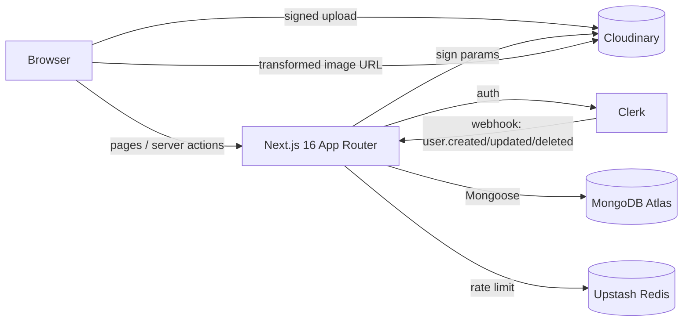

# 05: Making CloudArt a project recruiters remember

## The lens

A recruiter/hiring manager gives a resume project about 2 minutes. They look at, in this order: **live demo → README top → repo tree/CI badge → 1–2 source files → commit history.** Then, in an interview, they ask "what did *you* decide, and what would you change?"

So the goal isn't more features. It's **evidence of engineering judgment**: security, testing, CI, deployment, and a clear story.

## Be upfront about the template lineage

Names like `jsm_imaginify`, `creditFee`, the Stripe types, and the "credits" toast are recognizable from a very popular Next.js image-editor tutorial. That's not a sin (learning from tutorials is normal), but a reviewer who spots it will wonder what's yours. Two moves fix that:

1. **Remove the leftovers** (credit strings, Stripe types, preset name) and replace them with your own decisions.
2. **Say what you added/changed** in the README ("Differences from the tutorial baseline": guest trial mode, signed uploads, ownership checks, rate limiting, tests, CI, Docker hardening, before/after studio…). Own it in one honest paragraph. Interviewers respect that far more than being found out.

---

## README: the plan

Structure (top to bottom):

1. **Title + one-line pitch + badges** (CI status, coverage, license, live demo, Node/Next versions).
2. **Hero GIF or 3 screenshots** (studio with before/after slider; dashboard; mobile). 10–15 s GIF max.
3. **Live demo link + demo credentials or "try as guest"**. Also keep your Loom video, just don't make it the only visual.
4. **Features** (5–8 bullets, outcome-focused).
5. **Architecture** (Mermaid diagram, below) + a 5-line "how a transformation works".
6. **Key engineering decisions** (short ADR-style bullets, each with the *why*):
   - Clerk for auth + webhook sync into Mongo (why not roll your own)
   - Signed uploads + strict transformations (cost-abuse protection)
   - Server-side authorization in every action; zod at the boundary
   - Guest mode with rate limits
   - Standalone multi-stage non-root Docker image (size before → after)
7. **Security** section (threat model in 6 lines: authn/authz, input validation, upload abuse, secrets, headers).
8. **Quick start** (3 commands with Docker Compose), env var table (name / required / where to get it).
9. **Scripts** table (`pnpm dev/lint/typecheck/test/e2e/check`).
10. **Testing** (what's covered; how to run).
11. **Performance** (real Lighthouse numbers from prod, with date).
12. **Roadmap / known limitations** (honest list; signals maturity).
13. **License, credits** (Cloudinary, Clerk, shadcn/ui, Geist).

Architecture diagram (put straight into the README; GitHub renders it):

Also add: `docs/ARCHITECTURE.md` (data model, request flows), `docs/adr/0001-*.md` for 2–3 decisions, `SECURITY.md` (how to report vulns), `CONTRIBUTING.md`, `LICENSE` (MIT), PR + issue templates.

## Repo hygiene checklist

- [ ] No secrets in history (rotate + purge if needed); `gitleaks` in CI
- [ ] Rename package to `cloudart`, fix README (Next 16, Node ≥ 20.9)
- [ ] Delete dead code, commented CSS, unused deps, Lighthouse HTML dump, `IBMPlex`, Stripe types
- [ ] Conventional Commits from now on (`feat:`, `fix:`, `chore:`), small PRs even if you're the only dev; **use PRs for the cleanup work** so the history shows review-style thinking
- [ ] Repo description, topics, pinned on your profile; social preview image
- [ ] Tags/releases: `v1.0.0` with a short changelog

---

## Features ranked by impact ÷ effort

| # | Feature | Effort | Why it lands |
|---|---|---|---|
| 1 | **Before/after slider** (studio, detail page, landing) | S | Instantly visual; the screenshot everyone remembers |
| 2 | **Real quota/credits system** (per-user daily limit, counter in DB, shown in UI, 429 when exceeded) | M | Turns the fake "credit" text into a real feature; demonstrates rate limiting, transactions/atomic updates (`$inc`) |
| 3 | **Signed uploads + strict transformations + rate limiting** | M | Security story with a concrete threat ("stop anonymous users burning my AI credits") |
| 4 | **Version history per image** (each applied transform stored, click to revisit) | M | Non-trivial data modeling; makes the app feel like a real editor |
| 5 | **Public share links** (`visibility` flag, OG image per shared image) | S–M | Virality + shows authz nuance (private by default) |
| 6 | **Explore page** of public images with cursor pagination | M | Demonstrates pagination, indexes, caching (ISR) |
| 7 | **Batch processing** (multi-file, queue with progress) | M–L | Async UX, concurrency limits |
| 8 | **Stripe test-mode billing** for extra credits (you already have Stripe-shaped types) | L | Full SaaS loop: checkout, webhook, idempotency. Only do it after 1–6 are polished |
| 9 | **i18n with RTL support** (e.g. English + Arabic) | M | Rare in student projects; shows layout discipline |
| 10 | **Public REST endpoint + OpenAPI doc** (API key auth) | M | Shows API design |

If you only do three: **1, 2+3, 4.**

## Engineering practices worth showing (cheap, high signal)

- `env.ts` with zod: app refuses to boot with a clear message if config is wrong
- Typed action results (`{ ok: true, data } | { ok: false, error }`) + a tiny `safeAction` wrapper (auth + validation + error mapping) used by every action
- DTO mappers (no raw Mongoose docs crossing the server/client boundary)
- Structured logging (pino) + Sentry with source maps
- `/api/health`, graceful shutdown, Docker HEALTHCHECK
- Vercel Analytics is already there; add Web Vitals reporting
- Playwright + axe accessibility scan in CI
- Lighthouse CI budget
- Renovate/Dependabot + CodeQL

## Numbers you can claim (only after you measure them)

Before/after are the strongest resume material. Capture these *before* you start refactoring:

- Docker image size (current single-stage vs new standalone)
- Lighthouse mobile perf/LCP on production (landing page)
- Number of `any` in the codebase (grep) → 0
- Test count + coverage on `lib/`
- Number of server actions with auth + ownership checks (3/3 → and a test proving cross-user access is denied)
- CI wall time

Write them in a `docs/metrics.md` as you go.

## Resume bullets: templates (fill in real measured values; don't invent)

- Built **CloudArt**, a full-stack AI image-editing app (Next.js 16, TypeScript, MongoDB, Clerk, Cloudinary) with 5 generative transformations, guest trial mode, and a before/after comparison studio; deployed on Vercel and Docker.
- Hardened the app after a security review: server-side authorization and zod validation on all server actions, signed Cloudinary uploads with strict transformations, per-user rate limiting, and CSP/security headers, with tests proving cross-tenant access is denied.
- Cut Docker image from **[X] MB to [Y] MB** with a multi-stage, non-root standalone build; added health checks, Compose stack with local MongoDB, and Trivy scans in CI.
- Set up CI (GitHub Actions): lint, typecheck, unit + e2e tests ([N]% coverage on business logic), Docker build, gitleaks, CodeQL; improved mobile Lighthouse performance from **[A] to [B]**.

Keep it to 3–4 bullets on the resume; the README carries the rest. Link the live demo and repo.

## Interview prep: questions you should be able to answer after this work

1. Why are server actions "public endpoints", and how did you secure yours?
2. How does the Clerk → webhook → Mongo sync work? What if the webhook is delivered twice or out of order? (idempotent upsert on `clerkId`)
3. Why verify the webhook against the raw body?
4. How do you stop an anonymous user from running up your Cloudinary bill? (signed uploads, strict transformations, rate limits, usage alerts)
5. Why did you split `/` (static) from `/dashboard` (dynamic)? What does `auth()` vs `currentUser()` cost?
6. What does `output: "standalone"` change in the Docker image? Why non-root, why `node server.js` instead of `pnpm start`?
7. What would break if two requests updated the same image concurrently? (last-write-wins today; version field / optimistic concurrency)
8. What's your testing strategy and what's deliberately *not* tested?
9. What would you do next with another month? (roadmap: quotas → billing → batch)

## Deployment / demo tips

- Deploy production on Vercel with a **Clerk production instance** and a custom domain (removes the dev-instance handshake redirect you saw in Lighthouse). Keep a separate preview environment.
- Seed 6–8 "example" images (the guest gallery depends on `example: true` docs; an empty DB = an empty-looking demo).
- Put spending caps/alerts on Cloudinary and Atlas so a demo link can't hurt you.
- Record a 60–90 s demo video that opens with the before/after slider, not the login screen.
- Add UptimeRobot (or similar) pinging `/api/health`; a demo that's down when a recruiter clicks is the worst outcome.
